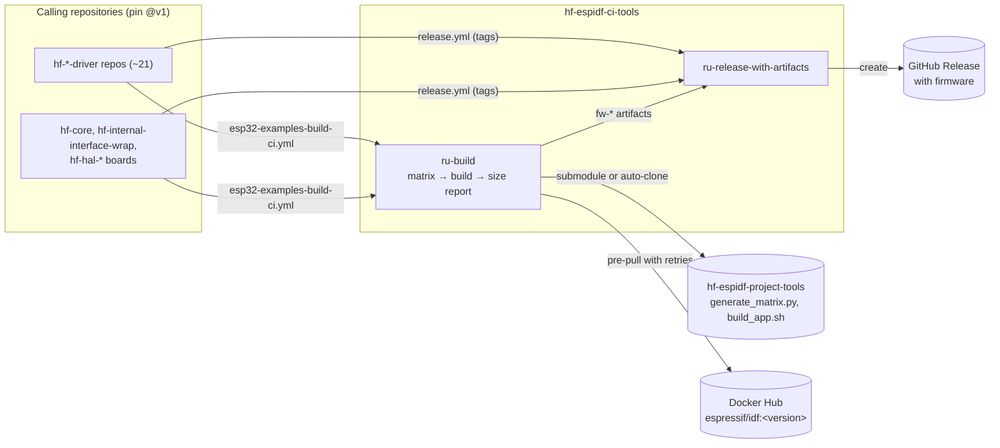

# 🔧 hf-espidf-ci-tools

Reusable GitHub Actions workflows for ESP-IDF projects. One builds firmware
across a matrix of ESP-IDF versions, build types and apps. The other
publishes a GitHub Release with the firmware built for that commit. The
matrix and the build scripts come from
[hf-espidf-project-tools](https://github.com/hardfoc/hf-espidf-project-tools).
C/C++ lint, docs and the CI gate live in
[hf-general-ci-tools](https://github.com/hardfoc/hf-general-ci-tools).

[](https://github.com/hardfoc/hf-espidf-ci-tools/actions/workflows/ci-self.yml)
[](LICENSE)
[](https://hardfoc.github.io/hf-espidf-ci-tools)

## Architecture



`ru-build` runs in three jobs:

1. **`generate-matrix`.** Finds the project tools, from a submodule, the
   `project_tools_dir` input, or an auto-clone. It then runs
   `generate_matrix.py`.
2. **`build`.** One job per matrix entry:
   1. frees runner disk space;
   2. pre-pulls `espressif/idf:<version>` with retries;
   3. builds with `espressif/esp-idf-ci-action`;
   4. uploads the build output as `fw-<app>-<idf>-<type>`.
3. **`size-report`.** On pull requests only, comments a firmware size table
   and, optionally, enforces a size budget.

`ru-release-with-artifacts` runs on a tag push. It downloads the `fw-*`
artifacts that the build workflow produced for the same commit, and attaches
them to a GitHub Release with generated notes.

Each workflow is self-contained. It calls only third-party actions, which are
pinned to commit SHAs, and nothing of this repository at a moving ref.
Pinning a caller to `@v1` therefore pins everything it runs.

## Versioning

Pin the moving major tag:

```yaml
uses: hardfoc/hf-espidf-ci-tools/.github/workflows/ru-build.yml@v1
```

Releases are semver tags (`v1.0.0`, ...). `v1` always points at the newest
`v1.x.y`. A removed input, a new required input or a new required permission
only arrives with a new major. Pull requests here are checked for exactly
those changes. See [docs/VERSIONING.md](docs/VERSIONING.md) and
[CHANGELOG.md](CHANGELOG.md).

> After a fix lands here, start a **new** run. "Re-run failed jobs" reuses the
> reusable-workflow revision that the original run resolved.

## Permissions contract

Each workflow declares minimal `permissions` on every job. A called workflow
cannot ask for more than its caller grants. If it does, the run fails before
any job starts (`startup_failure`). Grant **at least** the following. The
self-CI fails if a workflow's job permissions ever differ from this table.

<!-- permissions-table:start -->
| Workflow | Caller must grant | Why |
| --- | --- | --- |
| [`ru-build.yml`](.github/workflows/ru-build.yml) | `contents: read`, `pull-requests: write` | checkout; firmware size comment on pull requests |
| [`ru-release-with-artifacts.yml`](.github/workflows/ru-release-with-artifacts.yml) | `contents: write` | create the release and upload the firmware |
<!-- permissions-table:end -->

## Workflows: callers and inputs

The inputs tables are generated from the workflow files
(`.github/scripts/gen_readme_inputs.py`), and CI fails if they go stale.

### ru-build

```yaml
name: ESP32 build
on:
  push:
    branches: [main]
  pull_request:

jobs:
  build:
    uses: hardfoc/hf-espidf-ci-tools/.github/workflows/ru-build.yml@v1
    permissions:
      contents: read
      pull-requests: write
    with:
      project_dir: examples/esp32
      project_tools_dir: examples/esp32/scripts
```

<!-- inputs:ru-build.yml:start -->
| Input | Type | Required | Default | Description |
| --- | --- | --- | --- | --- |
| `project_dir` | string | yes | - | Path to the ESP-IDF project (contains CMakeLists.txt) |
| `project_tools_dir` | string | no | - | Path to project tools directory (contains scripts directly). Leave empty to auto-detect. |
| `clean_build` | boolean | no | `false` | Skip caches for a clean build. |
| `auto_clone_tools` | boolean | no | `true` | Auto-clone tools repo if project_tools_dir is missing |
| `max_dec_total` | string | no | `0` | Maximum total dec size in bytes for size budget enforcement (0 to disable) |
<!-- inputs:ru-build.yml:end -->

### ru-release-with-artifacts

```yaml
name: Release
on:
  push:
    tags: ["v*"]

jobs:
  release:
    uses: hardfoc/hf-espidf-ci-tools/.github/workflows/ru-release-with-artifacts.yml@v1
    permissions:
      contents: write
    with:
      build_workflow: esp32-examples-build-ci.yml
```

<!-- inputs:ru-release-with-artifacts.yml:start -->
| Input | Type | Required | Default | Description |
| --- | --- | --- | --- | --- |
| `build_workflow` | string | no | `esp32-examples-build-ci.yml` | Name of the ESP32 build workflow |
| `artifact_pattern` | string | no | `fw-.*` | Pattern for firmware artifacts |
| `draft` | boolean | no | `false` | Create as draft release |
| `prerelease` | boolean | no | `false` | Mark as pre-release |
| `tag_name` | string | no | `""` | Tag name for release (defaults to github.ref_name) |
| `fail_on_no_artifacts` | boolean | no | `false` | Fail if no firmware artifacts found |
<!-- inputs:ru-release-with-artifacts.yml:end -->

### Composite action: ensure-tools-directory

[`.github/actions/ensure-tools-directory`](.github/actions/ensure-tools-directory/action.yml)
resolves the project tools directory, or clones it. `ru-build` inlines the
same script, so the workflow does not depend on the action at a moving ref.
Use the action directly only in your own jobs.

> Earlier versions of this README showed a `security.yml` workflow. No such
> workflow exists in this repository, and
> [docs/security-workflow.md](docs/security-workflow.md) does not describe
> anything you can call.

## How this repository tests itself

| Workflow | What it checks |
| --- | --- |
| [`ci-self.yml`](.github/workflows/ci-self.yml) | Runs actionlint with shellcheck (pinned, any finding fails), and the same shellcheck on composite actions. Fails any `run:` block ending in a bare `cond && cmd`. Checks the permissions contract, the README inputs tables, that the inlined tools step matches the action, and breaking changes against the PR base. Runs unit tests for these checks |
| `ci-docs-publish.yml`, `ci-docs-linkcheck.yml`, `ci-markdown-lint.yml`, `ci-yaml-lint.yml` | This repository's documentation, through hf-general-ci-tools |

📖 Guides: [Build workflow](docs/build-workflow.md) ·
[Release workflow](docs/release-workflow.md) ·
[Example workflows](docs/example-workflows.md) ·
[Documentation index](docs/index.md)
