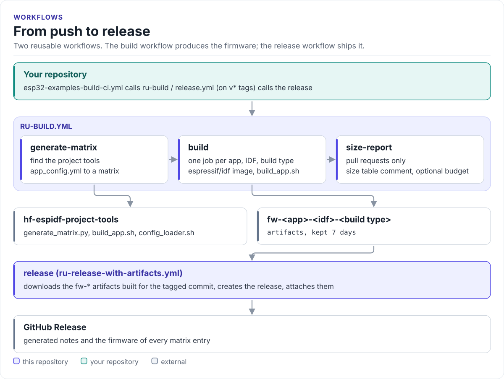

# ESP-IDF CI Tools

Reusable GitHub Actions workflows for HardFOC ESP-IDF projects: build every example app across ESP-IDF versions
and build types with a size report on pull requests, and attach the tested firmware to a GitHub Release.

[](https://github.com/hardfoc/hf-espidf-ci-tools/actions/workflows/ci-self.yml)
[](https://hardfoc.github.io/hf-espidf-ci-tools/)
[](LICENSE)
[](https://github.com/hardfoc/hf-espidf-ci-tools/releases)

**Documentation: <https://hardfoc.github.io/hf-espidf-ci-tools/>**

<!-- figure: workflow-flow -->
<picture>
  <source media="(prefers-color-scheme: dark)" srcset="docs/diagrams/workflow-flow.dark.svg">
  
</picture>
<!-- /figure -->

## In 30 seconds

With the apps listed in `examples/esp32/app_config.yml` and
[hf-espidf-project-tools](https://github.com/hardfoc/hf-espidf-project-tools) in `examples/esp32/scripts`:

```yaml
jobs:
  build:
    uses: hardfoc/hf-espidf-ci-tools/.github/workflows/ru-build.yml@v1
    permissions:
      contents: read
      pull-requests: write
    with:
      project_dir: examples/esp32
      project_tools_dir: examples/esp32/scripts
```

## What it does

- `ru-build.yml` turns `app_config.yml` into a matrix of apps, ESP-IDF versions and build types, and builds each
  one in the `espressif/idf` image.
- Pulls the image up to four times with back-off, so a Docker Hub error does not fail the build.
- Uploads each build as a `fw-<app>-<idf>-<build type>` artifact and comments a size table on pull requests, with
  an optional size budget.
- `ru-release-with-artifacts.yml` attaches the firmware built for the tagged commit to a GitHub Release; nothing is
  rebuilt.
- Every action is pinned to a commit SHA; `@v1` never removes an input or asks for a new permission, and the
  self-CI enforces it.

## Install

Nothing to install: call the workflows from your repository, pinned to the major tag.

```yaml
uses: hardfoc/hf-espidf-ci-tools/.github/workflows/ru-build.yml@v1
uses: hardfoc/hf-espidf-ci-tools/.github/workflows/ru-release-with-artifacts.yml@v1
```

## Permissions contract

The self-CI checks this table against every job (`.github/scripts/check_permissions.py`). A caller that grants
less gets `startup_failure`.

<!-- permissions-table:start -->
| Workflow | Caller must grant | Why |
| --- | --- | --- |
| [`ru-build.yml`](.github/workflows/ru-build.yml) | `contents: read`, `pull-requests: write` | checkout; firmware size comment on pull requests |
| [`ru-release-with-artifacts.yml`](.github/workflows/ru-release-with-artifacts.yml) | `contents: write` | create the release and upload the firmware |
<!-- permissions-table:end -->

## Inputs

Generated from the workflow files (`.github/scripts/gen_readme_inputs.py`); CI fails when they go stale.

### ru-build

<!-- inputs:ru-build.yml:start -->
| Input | Type | Required | Default | Description |
| --- | --- | --- | --- | --- |
| `project_dir` | string | yes | - | Path to the ESP-IDF project (contains CMakeLists.txt) |
| `project_tools_dir` | string | no | - | Path to project tools directory (contains scripts directly). Leave empty to auto-detect. |
| `clean_build` | boolean | no | `false` | Skip caches for a clean build. |
| `auto_clone_tools` | boolean | no | `true` | Auto-clone tools repo if project_tools_dir is missing |
| `max_dec_total` | string | no | `0` | Maximum total dec size in bytes for size budget enforcement (0 to disable) |
<!-- inputs:ru-build.yml:end -->

### ru-release-with-artifacts

<!-- inputs:ru-release-with-artifacts.yml:start -->
| Input | Type | Required | Default | Description |
| --- | --- | --- | --- | --- |
| `build_workflow` | string | no | `esp32-examples-build-ci.yml` | Name of the ESP32 build workflow |
| `artifact_pattern` | string | no | `fw-.*` | Pattern for firmware artifacts |
| `draft` | boolean | no | `false` | Create as draft release |
| `prerelease` | boolean | no | `false` | Mark as pre-release |
| `tag_name` | string | no | `""` | Tag name for release (defaults to github.ref_name) |
| `fail_on_no_artifacts` | boolean | no | `false` | Fail if no firmware artifacts found |
<!-- inputs:ru-release-with-artifacts.yml:end -->

## Documentation

| Page | What it covers |
| --- | --- |
| [Quickstart](https://hardfoc.github.io/hf-espidf-ci-tools/latest/quickstart/) | The three files a repository needs |
| [ru-build](https://hardfoc.github.io/hf-espidf-ci-tools/latest/ru-build/) | Jobs, tools lookup, matrix, artifacts, size budget, failure modes |
| [ru-release-with-artifacts](https://hardfoc.github.io/hf-espidf-ci-tools/latest/ru-release-with-artifacts/) | Releasing the tested firmware |
| [Permissions contract](https://hardfoc.github.io/hf-espidf-ci-tools/latest/permissions/) | What to grant and why |
| [Versioning](https://hardfoc.github.io/hf-espidf-ci-tools/latest/versioning/) | `@v1`, what is breaking, cutting a release |
| [Migrating to v1](https://hardfoc.github.io/hf-espidf-ci-tools/latest/migration/) | Moving a caller from `@main` |

## Tests

```bash
python .github/scripts/test_checks.py && python .github/scripts/check_permissions.py
```

## License

GPL-3.0; see [LICENSE](LICENSE).
