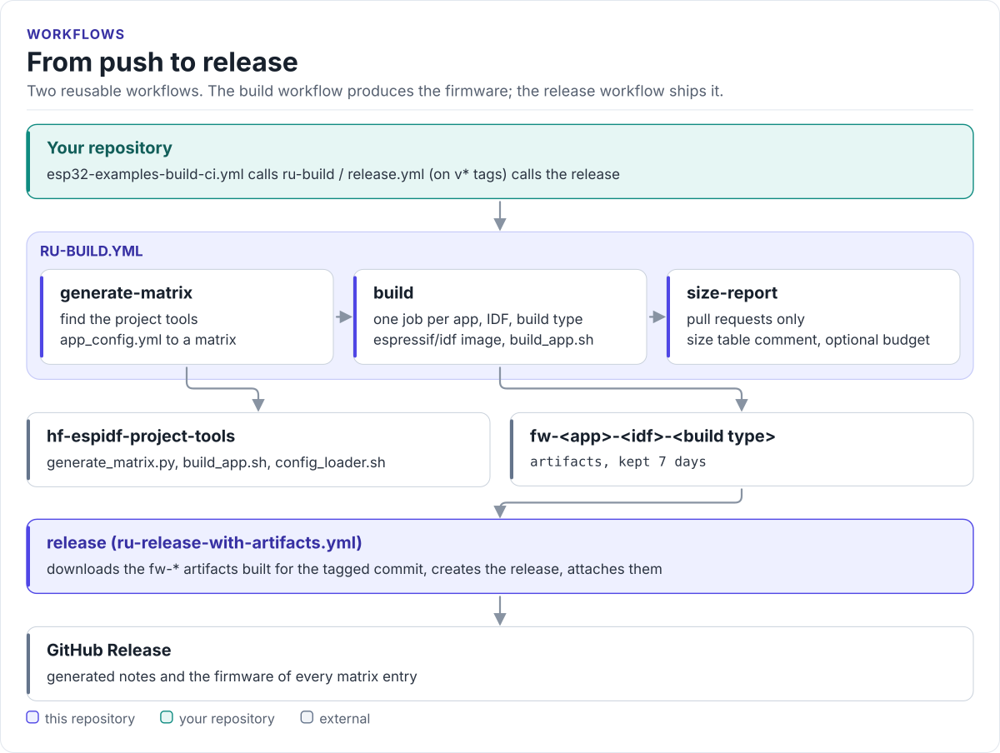

---
hide:
  - navigation
  - toc
---

HardFOC CI tools

# ESP-IDF CI Tools

Reusable GitHub Actions workflows for ESP-IDF projects. One builds every example app across a matrix of ESP-IDF
versions and build types and reports the firmware size; the other attaches that firmware to a GitHub Release.

[Quickstart](quickstart.md){ .md-button .md-button--primary }
[ru-build](ru-build.md){ .md-button }
[Source on GitHub](https://github.com/hardfoc/hf-espidf-ci-tools){ .md-button }

Every HardFOC driver, `hf-core`, `hf-internal-interface-wrap` and the board HALs build their ESP32 examples with
these workflows. A caller writes about fifteen lines of YAML and pins `@v1`; the matrix comes from the caller's own
`app_config.yml`, read by the scripts in
[hf-espidf-project-tools](https://github.com/hardfoc/hf-espidf-project-tools). C++ lint, documentation and the CI
gate live in [hf-general-ci-tools](https://github.com/hardfoc/hf-general-ci-tools).

<!-- figure: workflow-flow -->
<picture>
  <source media="(prefers-color-scheme: dark)" srcset="diagrams/workflow-flow.dark.svg">
  
</picture>
<!-- /figure -->

## What it provides

| Workflow or action | What it does | Caller grants |
| --- | --- | --- |
| [`ru-build.yml`](ru-build.md) | Builds every app, IDF version and build type in `app_config.yml`, uploads `fw-*` artifacts, comments a size table on pull requests | `contents: read`, `pull-requests: write` |
| [`ru-release-with-artifacts.yml`](ru-release-with-artifacts.md) | On a tag, creates a GitHub Release with the `fw-*` artifacts built for that commit | `contents: write` |
| [`ensure-tools-directory`](ensure-tools-directory.md) | Composite action: finds or clones hf-espidf-project-tools in your own jobs | none |

## What you get

- **One matrix, one source.** The apps, ESP-IDF versions, build types and exclusions are read from
  `app_config.yml`, the same file the local build scripts use. See [ru-build](ru-build.md#the-matrix).
- **Builds that survive Docker Hub.** The image is pulled up to four times with back-off before the build.
- **A size table on every pull request**, and an optional size budget that fails the run.
- **Releases that ship what was tested.** The release attaches the artifacts of the build that ran on the tagged
  commit; nothing is rebuilt. See [ru-release-with-artifacts](ru-release-with-artifacts.md).
- **A stable contract.** `@v1` never removes an input or asks for a new permission; the self-CI enforces it. See
  [Versioning](versioning.md) and the [permissions contract](permissions.md).

## Where to go next

-   :material-rocket-launch-outline: **[Quickstart](quickstart.md)**

    ---

    Add the build workflow to a repository with ESP32 examples.

-   :material-hammer-wrench: **[ru-build](ru-build.md)**

    ---

    Jobs, inputs, artifacts, size report and failure modes.

-   :material-tag-outline: **[ru-release-with-artifacts](ru-release-with-artifacts.md)**

    ---

    Ship the tested firmware with each version tag.

-   :material-shield-check-outline: **[Permissions contract](permissions.md)**

    ---

    What a caller must grant, and why a missing grant fails at startup.

